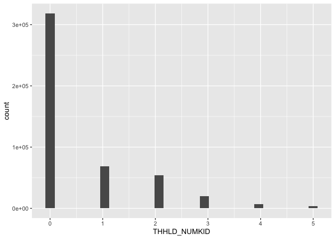
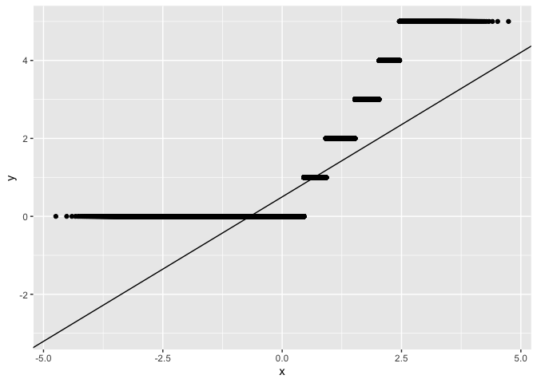

# Geog4/6300: Lab 4


- [<span class="toc-section-number">1</span> One and two sample
  difference tests](#one-and-two-sample-difference-tests)
- [<span class="toc-section-number">2</span> Assessment
  criteria](#assessment-criteria)
  - [<span class="toc-section-number">2.1</span> Loading/filtering data
    and checking for
    normality.](#loadingfiltering-data-and-checking-for-normality)
  - [<span class="toc-section-number">2.2</span> Testing the difference
    in number of
    children.](#testing-the-difference-in-number-of-children)
  - [<span class="toc-section-number">2.3</span> Identifying differences
    in time displaced by natural disasters across income
    groups](#identifying-differences-in-time-displaced-by-natural-disasters-across-income-groups)
  - [<span class="toc-section-number">2.4</span> Challenge
    Question:](#challenge-question)
  - [<span class="toc-section-number">2.5</span> Final submission
    stuff](#final-submission-stuff)

## One and two sample difference tests

**Overview:** In this lab, you’ll be doing analysis with public use
microdata from the Household Pulse survey administered by the U.S.
Census Bureau during the COVID pandemic. The survey had a particular
focus on pandemic effects on health and wellbeing, but it also included
questions on the impact of natural disasters on households. That’s the
section you’ll be focusing on here.

Unlike the aggregate census data you’re probably used to working with,
microdata provide anonymized individual-level responses that researchers
can use to calculate their own summary statistics and estimates.

There’s more info on the Pulse survey and the public use microdata file
at this link:

- [Household Pulse Survey Public Use
  Files](https://www.census.gov/programs-surveys/household-pulse-survey/data/datasets.html)

The main data are contained in the `pulse_2023` csv file in the data
folder. The data dictionary for this dataset is also available in the
data folder.

You’ll use this data to answer two research questions:

- Did households displaced by natural disasters include more children
  than those not displaced?
- Is there a relationship between household income and a household’s
  ability to return to its place of residence after being displaced?

## Assessment criteria

This lab assesses the following learning standards:

21. Assess the normality of a variable and use those results to select
    between parametric and non-parametric statistical tests.
22. Apply two-sample tests of difference and accurately interpret
    results in terms of hypothesis testing, statistical significance,
    and the direction and magnitude of any differences.
23. Construct contingency tables and apply chi-square tests to assess
    association between categorical variables, interpreting results in
    terms of significance and practical meaning.

### Loading/filtering data and checking for normality.

In the first part of the lab, you’ll be using two variables:
THHLD_NUMKID (number of children in a household) and ND_DISPLACE
(whether a household was displaced by a natural disaster in the last
year).

Load the dataset using read_csv, and also take a look at the two
variables of interest in the data dictionary. For this lab, you only
want observations with valid responses, filtering out records where
respondents did not provide an answer. Filter these data so you have
only valid responses.

**Task 1** *Load the Pulse data and filter it to only valid responses.*

``` r
pulse_data <- read.csv("data/pulse_2023.csv")

pulse_filtered <- pulse_data %>%
  filter(ND_DISPLACE != -99 & ND_DISPLACE != -88)
```

You’ll be conducting a two-sample test of difference to look at whether
the number of children differs between those displaced and not
displaced. To know which test to use, you have to assess the normality
of the THHLD_NUMKID variable.

**Task 2** *Assess the normality of this variable using either a
histogram OR a qq line. Make sure your plot is visible and interpret
what it shows you about the normality of this variable.*

``` r
ggplot(pulse_filtered,aes(x=THHLD_NUMKID)) + 
  geom_histogram()
```

    `stat_bin()` using `bins = 30`. Pick better value `binwidth`.



``` r
ggplot(pulse_filtered,aes(sample=THHLD_NUMKID)) +
  stat_qq()+
  stat_qq_line()
```



### Testing the difference in number of children.

Now you can test whether the number of children differs between
displaced and non-displaced households.

**Task 3** *Based on the normality of the data, what is the appropriate
statistical test for determining whether the number of children differs
between these two groups? Explain why this test is appropriate and give
a null and alternative hypothesis for this test*

Since the data is skewed right, the best statistical test to use is a
Wilcoxon Rank Sum Test as it is a t-test that is suitable for data that
is not normally distributed. This test ranks observations rather than
calculating the means which will prevent outliers from affecting the
outcome. It will compare the number of children (THHLD_NUMKID) who were
displaced (ND_DISPLACE = 1) with the number of children who were not
displaced (ND_DISPLACE = 2). The null hypothesis for this test is that
there is no difference between the number of children in households that
were displaced by natural disasters and households that were not
displaced.

**Task 4** *Run the test you identified in Task 3. Also calculate the
mean for each dataset, which you can use to determine the nature of the
difference–which group (if any) has more children.*

``` r
displaced <- pulse_filtered %>%
  filter(ND_DISPLACE == 1)

not_displaced <- pulse_filtered %>%
  filter(ND_DISPLACE == 2)

wilcox.test(displaced$THHLD_NUMKID, not_displaced$THHLD_NUMKID)
```


        Wilcoxon rank sum test with continuity correction

    data:  displaced$THHLD_NUMKID and not_displaced$THHLD_NUMKID
    W = 1171425061, p-value = 2.463e-12
    alternative hypothesis: true location shift is not equal to 0

``` r
mean_displaced <- pulse_filtered %>%
  group_by(ND_DISPLACE) %>%
  summarize(mean = mean(THHLD_NUMKID))
```

**Task 5** *Interpret the results of the analysis you did in task 4.* \*
Do you reject the null hypothesis? Why or why not? \* Based on the test
result and the group means, what can we conclude about differences in
the number of children between these two groups?

The p-value for the Wilcoxon Rank Sum Test was 3.769e-08, which means
that we reject the null hypothesis because the value was incredibly
small. This means that the number of children in households that were
displaced by natural disasters differs from the number of children in
households that were not displaced. Based on the means of the two
groups, households that were displaced (ND_DISPLACE = 1) have a greater
average of 0.8244937 children while households that were not displaced
(ND_DISPLACE = 2) have an average of 0.5700263 children. This could be
due to a difference is age demographics as older populations may be more
likely to live in more structurally sound homes while younger
populations that have children are more likely to live in starter homes
that are not as structurally sound.

### Identifying differences in time displaced by natural disasters across income groups

In Part 2, you used a test of difference that included a continuous and
categorical variable. In this section, you’ll focus only on households
displaced by natural disasters to identify statistically significant
differences in time displaced using two categorical variables: one
placing responses into groups by income (INCOME) and the other showing
the time displaced (ND_HOWLONG).

Again, look at the data dictionary to better understand how these two
variables are structured.

**Task 6** *Reload the original, unfiltered Pulse dataset (not the one
you used in parts 1 and 2). Select only observations for households
displaced by a natural disaster using the ND_DISPLACE variable. Then
filter for records with valid responses to INCOME and ND_HOWLONG. Call
the head of the table with `kable` when done.*

``` r
pulse_filtered2 <- pulse_data %>% 
  filter(ND_DISPLACE == 1) %>%
  filter(INCOME != -99 & INCOME != -88) %>%
  filter(ND_HOWLONG != -99 & ND_HOWLONG != -88)

kable(head(pulse_filtered2))
```

| SCRAM | WEEK | EST_ST | EST_MSA | REGION | HWEIGHT | PWEIGHT | TBIRTH_YEAR | ABIRTH_YEAR | RHISPANIC | AHISPANIC | RRACE | ARACE | EEDUC | AEDUC | MS | EGENID_BIRTH | AGENID_BIRTH | GENID_DESCRIBE | SEXUAL_ORIENTATION | THHLD_NUMPER | AHHLD_NUMPER | THHLD_NUMKID | AHHLD_NUMKID | THHLD_NUMADLT | KIDS_LT5Y | KIDS_5_11Y | KIDS_12_17Y | INCOME | ND_DISPLACE | ND_TYPE1 | ND_TYPE2 | ND_TYPE3 | ND_TYPE4 | ND_TYPE5 | ND_HOWLONG | ND_DAMAGE | ND_FDSHRTAGE | ND_WATER | ND_ELCTRC | ND_UNSANITARY | ND_ISOLATE | ND_CRIME | ND_SCAM | MEDICAID | MEDICAID_NO | FDBENEFIT3 | LIVQTRRV |
|:---|---:|---:|---:|---:|---:|---:|---:|---:|---:|---:|---:|---:|---:|---:|---:|---:|---:|---:|---:|---:|---:|---:|---:|---:|---:|---:|---:|---:|---:|---:|---:|---:|---:|---:|---:|---:|---:|---:|---:|---:|---:|---:|---:|---:|---:|---:|---:|
| V560000089 | 56 | 21 | NA | 2 | 1607.2081 | 3016.3389 | 1987 | 2 | 1 | 2 | 1 | 2 | 7 | 2 | 1 | 1 | 2 | 1 | 2 | 2 | 2 | 0 | 2 | 2 | -88 | -88 | -88 | 3 | 1 | -99 | -99 | -99 | -99 | 1 | 1 | 2 | 1 | 1 | 3 | 1 | 1 | 1 | 1 | 3 | -88 | 1 | 2 |
| V560000117 | 56 | 42 | NA | 1 | 3166.8361 | 8755.5654 | 1953 | 2 | 1 | 2 | 1 | 2 | 4 | 2 | 1 | 1 | 2 | 1 | 2 | 3 | 2 | 0 | 2 | 3 | -88 | -88 | -88 | 4 | 1 | -99 | -99 | -99 | -99 | 1 | 1 | 3 | 2 | 1 | 4 | 1 | 3 | 3 | 4 | 3 | -88 | 1 | 1 |
| V560000205 | 56 | 21 | NA | 2 | 828.5883 | 3110.1176 | 1954 | 2 | 1 | 2 | 1 | 2 | 6 | 2 | 5 | 2 | 2 | 2 | 2 | 4 | 2 | 0 | 2 | 4 | -88 | -88 | -88 | 4 | 1 | -99 | 1 | -99 | -99 | -99 | 5 | 4 | 1 | 1 | 4 | 3 | 4 | 1 | 3 | 3 | -88 | 1 | 2 |
| V560000506 | 56 | 26 | 19820 | 3 | 1024.8124 | 950.5055 | 1964 | 2 | 1 | 2 | 1 | 2 | 6 | 2 | 5 | 1 | 2 | 1 | 2 | 1 | 2 | 0 | 2 | 1 | -88 | -88 | -88 | 6 | 1 | -99 | -99 | -99 | -99 | 1 | 1 | 2 | 1 | 1 | 3 | 1 | 2 | 1 | 1 | 3 | -88 | 1 | 2 |
| V560000603 | 56 | 45 | NA | 2 | 1084.5817 | 2045.7398 | 1971 | 2 | 1 | 2 | 1 | 2 | 6 | 2 | 1 | 1 | 2 | 1 | 2 | 2 | 2 | 0 | 2 | 2 | -88 | -88 | -88 | 8 | 1 | 1 | -99 | -99 | -99 | -99 | 1 | 1 | 1 | 1 | 2 | 1 | 1 | 1 | 4 | 3 | -88 | 1 | 2 |
| V560000686 | 56 | 37 | NA | 2 | 650.4371 | 636.1618 | 1969 | 2 | 1 | 2 | 1 | 2 | 5 | 2 | 3 | 2 | 2 | 2 | 2 | 2 | 2 | 1 | 2 | 1 | -99 | -99 | 1 | 1 | 1 | -99 | -99 | -99 | 1 | -99 | 5 | 4 | 3 | 1 | 2 | 1 | 1 | 1 | 1 | -88 | -88 | 1 | 3 |

**Task 7** *Create a contingency table of responses to the ND_HOWLONG
variable by INCOME. The rows of this table should be the income groups
and the columns should be the categorical variables showing time
displaced. Call the table when you are done.*

``` r
pulse_table <- pulse_filtered2 %>%
  count(ND_HOWLONG, INCOME, name = "count") %>%
  pivot_wider(names_from = ND_HOWLONG, values_from = count, values_fill = 0)

kable(head(pulse_table))
```

| INCOME |   1 |   2 |   3 |   4 |   5 |
|-------:|----:|----:|----:|----:|----:|
|      1 | 286 | 218 | 115 |  69 | 179 |
|      2 | 162 | 122 |  50 |  23 |  63 |
|      3 | 221 | 135 |  67 |  32 |  50 |
|      4 | 316 | 160 |  78 |  42 |  52 |
|      5 | 219 | 107 |  54 |  23 |  33 |
|      6 | 317 | 115 |  58 |  37 |  37 |

**Task 8** *Run a chi-square test on your contingency table to assess
whether there are statistically significant differences in displacement
time between these income groups. You’ll likely need to delete the
INCOME variable to do so.*

``` r
chisq.test(pulse_table %>% select(-INCOME))
```


        Pearson's Chi-squared test

    data:  pulse_table %>% select(-INCOME)
    X-squared = 210.51, df = 28, p-value < 2.2e-16

**Task 9** *To help with your interpretation of results, Calculate the
percentage of households within each income group that fall into
category 1 of ND_HOWLONG (“displaced less than a week”).*

``` r
pulse_table_pct <- pulse_table %>%
  pivot_longer(-INCOME,
               names_to = "ND_HOWLONG",
               values_to = "count") %>%
  group_by(INCOME) %>% mutate(total = sum(count)) %>%
  mutate(pct = round(count / sum(count) * 100, 1)) %>%
  select(-count) %>%
  pivot_wider(names_from = ND_HOWLONG,
              values_from = pct)
```

**Task 10** *Interpret the results of your analysis in tasks 8 and 9.*
\* Do you reject the null hypothesis based on these results and why (or
why not)? \* What do your results in Task 9 tell you about differences
in how quickly households were able to return?

We reject the null hypothesis because the p-value of 2.2e-16 is very
low. This means that there is a relationship between income level and
the amount of time a household is displaced. It can be assumed that
households with a lower income are more likely to be displaced for a
longer period of time that households with a greater income. Only 33% of
households that have a total household income less than \$25,000 were
able to return after a week of being displaced while over 50% of
households that have an income of \$75,000 and greater were able to
return after a week. As the number of weeks increase, the percentage of
households with a lower income level who are able to return increases as
the percentage of households with a greater income level decreases. This
could likely be due to lower income households experiencing greater
damage or not having enough money in their emergency fund. It could also
be because higher income households are prioritized more during natural
disasters.

### Challenge Question:

Calculate and map the percentage of households reporting displacement
(ND_DISPLACE) by state. To do so, you’ll need to start with a version of
the dataset that excludes non-valid responses and then calculate the
percentage displaced by state.

Once you’ve calculated that estimate, map it out using the
`states_albers` geopackage file in the data folder. Provide a brief
description of the patterns you observe.

``` r
#Code goes here
```

### Final submission stuff

**Disclosure of assistance:** Besides class materials, what other
sources of assistance did you use while completing this lab? These can
include input from classmates, relevant material identified through web
searches (e.g., Stack Overflow), or assistance from ChatGPT or other AI
tools. How did these sources support your own learning in completing
this lab?

I used Google’s AI overview to clarify the difference between the
statistical tests as well as the code for creating a the percentages
table; however, I primarily referred back to the class scripts to help
me write my code.

**Lab reflection:** How do you feel about the work you did on this lab?
Was it easy, moderate, or hard? What are the biggest things you learned
by completing it?

I feel good about the work I did on this lab. I found the code easier
than the last lab, but the analysis was a bit more difficult.
